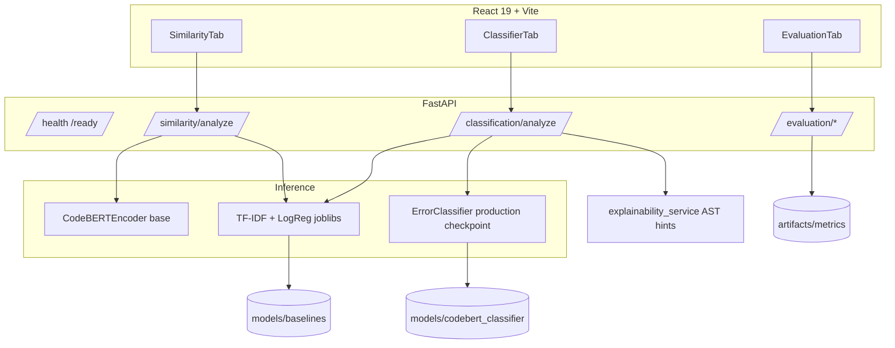

# CodeInsight AI — Architecture

## Classification path

1. `POST /api/classification/analyze` → `analyze_code()`
2. AST validation (`code_validator`) — no execution of user code
3. Load **`settings.classifier_model_path`** → `models/codebert_classifier/`
4. Fallback: baseline joblibs
5. Response includes `probabilities`, deterministic `feedback`, and `diagnostics`

## Similarity path

1. `POST /api/similarity/analyze` → `analyze_similarity()`
2. CodeBERT mean-pooled embeddings + cosine similarity
3. TF-IDF cosine baseline
4. Threshold comparison — scores are **not** calibrated probabilities

## Evaluation artifacts

| Run | Metrics directory |
|-----|-------------------|
| Production | `artifacts/metrics/codebert_classification_metrics.json` |
| Experiment | `artifacts/metrics/experiments/<run_id>/` |

API inference always uses **production** checkpoint unless configuration is changed.
